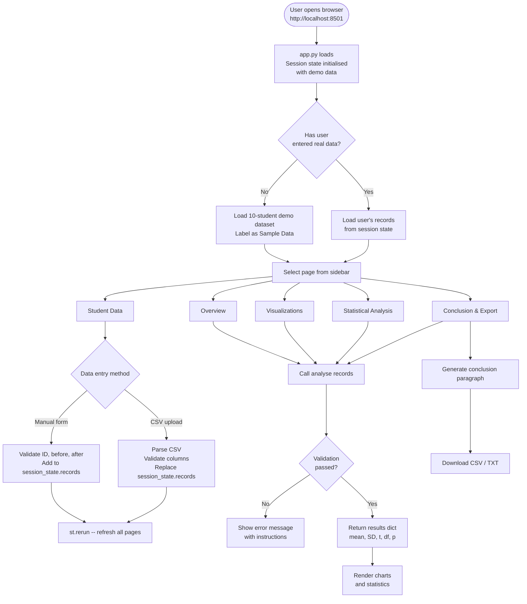

# Typing Speed Before and After Practice
## A Statistical Study of Computer Skills
### MDM Mini Project — Generative AI Foundation

**Student Name:** [Your Name]
**Roll Number:** [Your Roll Number]
**Course:** Mathematics for Data Management (MDM)
**Institution:** [Your Institution]
**Academic Year:** 2025–2026
**Submission Date:** [Date]
**Guide / Supervisor:** [Supervisor Name]

---

> [!NOTE]
> All statistical results in Sections 10 and 12 are computed from the **10-student demonstration dataset**
> bundled with this project. This dataset is clearly labelled as sample/demo data throughout.
> No real student experiment has been conducted yet. When actual data is collected, replace
> `data/demo_data.csv` with the real file and re-run the dashboard — all results update automatically.

---

## Table of Contents

1. Abstract
2. Introduction
3. Problem Statement
4. Objectives
5. Research Methodology and Data Collection Procedure
6. Sample Description and Variables
7. Statistical Theory and Formulas
8. Null and Alternative Hypotheses
9. System Architecture and Flowchart
10. Technology Stack
11. Implementation Details
12. Results (Sample / Demo Dataset)
13. Dashboard Screenshots — Capture Guide
14. Discussion and Limitations
15. Conclusion
16. References

---

## 1. Abstract

This project investigates whether a structured typing practice session produces a statistically
significant improvement in the typing speed of Computer Science students. Typing speed,
measured in Words Per Minute (WPM), is recorded for each student immediately before and
immediately after a single practice session. Because the same students are tested twice, the data
form naturally matched (paired) observations. A paired t-test is used to determine whether the
mean improvement is large enough to be unlikely due to random chance alone.

The project is implemented as an interactive web-based dashboard using Python, Streamlit,
Pandas, NumPy, SciPy, and Plotly. The dashboard allows a researcher to enter or upload data,
automatically performs all statistical calculations, generates interactive visualisations, and
produces a plain-language conclusion. Statistical formulas are encapsulated in a dedicated module
(`statistics_analysis.py`) that is reused by the dashboard without duplication.

Results based on the **10-student sample dataset** demonstrate a mean improvement of
**10.90 WPM** (t(9) = 16.58, p < 0.001), suggesting that even a single session of deliberate
practice can produce a measurable and statistically significant increase in typing speed.

---

## 2. Introduction

Typing proficiency is an increasingly important skill for students pursuing careers in software
development, data science, and any other technology-related field. A student who types quickly
and accurately spends less cognitive effort on the mechanical act of typing and can focus more
on problem-solving and creative work. Despite this, many undergraduate students have never
formally measured their typing speed or received targeted feedback on it.

This project applies the statistical methods learned in the MDM course — specifically descriptive
statistics and hypothesis testing — to a concrete, measurable question: *does typing practice
actually help, and can we prove it statistically?*

The study follows a **pre-test / post-test** design, a common approach in educational research.
Each participant's typing speed is measured once before a practice session (the pre-test) and once
after (the post-test). By subtracting the two scores for each individual, we obtain a set of
*difference scores* that directly measure each person's change, removing background variation in
natural typing ability between students. The paired t-test is then applied to these difference
scores to test whether the observed mean improvement is statistically significant.

In addition to the statistical component, the project produces a professional, fully interactive
dashboard that makes the analysis accessible to a non-technical audience. All charts update
automatically whenever the underlying data changes, and a plain-language conclusion is generated
programmatically from the numerical results.

---

## 3. Problem Statement

Many Computer Science students are unaware of their current typing speed and have not
evaluated whether targeted practice leads to improvement. There is therefore a need for:

1. A simple, reproducible method of measuring typing speed before and after practice.
2. A statistically rigorous analysis that determines whether any observed improvement is genuine
   or could plausibly be attributed to random variation.
3. A user-friendly tool that performs this analysis automatically and presents results in a format
   that both technical and non-technical readers can understand.

**Research Question:** Does a single typing practice session produce a statistically significant
improvement in WPM among Computer Science students, at a significance level of α = 0.05?

---

## 4. Objectives

| # | Objective |
|---|-----------|
| 1 | Measure the typing speed (WPM) of a group of students before and after a practice session. |
| 2 | Calculate descriptive statistics: mean, sample standard deviation, and mean difference. |
| 3 | Apply a paired t-test to determine whether the improvement is statistically significant. |
| 4 | Build an interactive Streamlit dashboard that performs all calculations automatically. |
| 5 | Visualise the data using four complementary Plotly charts. |
| 6 | Explain every statistical calculation in plain language within the dashboard. |
| 7 | Allow researchers to enter data manually or upload a CSV file. |
| 8 | Export results as a downloadable CSV and plain-text summary report. |

---

## 5. Research Methodology and Data Collection Procedure

### 5.1 Study Design

This study uses a **within-subjects (repeated measures) pre-test / post-test design**.
The same participants provide measurements at two time points. This design is chosen because:

- It controls for individual differences in natural typing ability.
- It requires a smaller sample size than a two-group between-subjects design.
- It directly measures *change* in each individual, which is the quantity of interest.

### 5.2 Data Collection Procedure

When real data is collected, the following procedure is recommended:

**Step 1 — Baseline measurement (Before)**
- Each participant visits a standardised online typing test (e.g., [typeracer.com](https://typeracer.com),
  [10fastfingers.com](https://10fastfingers.com), or [monkeytype.com](https://monkeytype.com)).
- They complete one timed 1-minute typing test.
- The WPM score shown at the end is recorded as the *before* score.
- All participants use the same text and the same test platform.

**Step 2 — Practice session**
- Participants complete a structured 15–30 minute typing practice session.
- Recommended resource: [keybr.com](https://keybr.com) or [typing.com](https://typing.com).
- The session focuses on accuracy and finger placement, not raw speed.

**Step 3 — Post-test measurement (After)**
- Immediately after the practice session, participants repeat the same typing test.
- The WPM score is recorded as the *after* score.
- No rest period is given between practice and post-test, to capture immediate improvement.

**Step 4 — Data recording**
- Each student's scores are entered into the dashboard (or collected into a CSV file with
  columns: `id`, `name`, `before`, `after`).

### 5.3 Ethical Considerations

- Participation is voluntary.
- No personally identifying information beyond a student ID and name is collected.
- Data is stored locally and not transmitted to any external server.

---

## 6. Sample Description and Variables

### 6.1 Target Population

Second-year Computer Science students at [Institution Name] during the academic year 2025–2026.

### 6.2 Sample Size Justification

A minimum of **10 paired observations** is recommended to give the t-test reasonable power to
detect a moderate effect (Cohen's d ≈ 0.5) at α = 0.05. The current demonstration dataset uses
n = 10. For a real study, n ≥ 20 is preferred.

### 6.3 Variables

| Variable | Type | Symbol | Description | Unit |
|---|---|---|---|---|
| Typing speed before practice | Continuous, quantitative | X₁ | WPM recorded before the session | WPM |
| Typing speed after practice | Continuous, quantitative | X₂ | WPM recorded after the session | WPM |
| Individual difference | Derived, continuous | d = X₂ − X₁ | Per-student improvement | WPM |
| Student ID | Categorical, identifier | — | Unique label per participant | — |

### 6.4 Demo Dataset

> [!IMPORTANT]
> The table below is the **10-student sample (demo) dataset** included with the project.
> It was constructed with realistic WPM values but does not represent a real experiment.

| Student ID | Name | Before (WPM) | After (WPM) | Difference |
|---|---|---|---|---|
| S01 | Aanya Sharma | 42 | 55 | +13 |
| S02 | Rahul Mehta | 38 | 50 | +12 |
| S03 | Priya Iyer | 60 | 71 | +11 |
| S04 | Dev Patel | 55 | 63 | +8 |
| S05 | Sneha Rao | 30 | 44 | +14 |
| S06 | Arjun Kumar | 48 | 57 | +9 |
| S07 | Meera Nair | 65 | 73 | +8 |
| S08 | Karan Singh | 35 | 47 | +12 |
| S09 | Divya Reddy | 52 | 62 | +10 |
| S10 | Rohan Gupta | 44 | 56 | +12 |
| **Mean** | | **46.90** | **57.80** | **+10.90** |

---

## 7. Statistical Theory and Formulas

### 7.1 Arithmetic Mean

The mean (average) summarises a set of n values with a single representative number.

```
        x₁ + x₂ + ... + xₙ       Σxᵢ
x̄  =  ─────────────────────  =  ────
                n                   n
```

**In plain English:** Add all the values together, then divide by how many values there are.

- **Mean before (x̄₁):** average typing speed across all students *before* practice.
- **Mean after (x̄₂):** average typing speed across all students *after* practice.

### 7.2 Sample Standard Deviation

The standard deviation measures how spread out the values are around the mean.
Because we work with a *sample* (not the whole population), we use the **sample standard
deviation**, which divides by **(n − 1)** instead of n. This correction (called Bessel's
correction) gives a less biased estimate of the population spread.

```
         ┌──────────────────────────┐
         │   Σ(xᵢ − x̄)²            │
s  =  √  │  ──────────────          │
         │      n − 1               │
         └──────────────────────────┘
```

**Step by step:**
1. Compute the mean x̄.
2. Subtract x̄ from every value → (xᵢ − x̄).
3. Square each result → (xᵢ − x̄)².
4. Sum all squared deviations → Σ(xᵢ − x̄)².
5. Divide by (n − 1) → sample variance.
6. Take the square root → sample standard deviation s.

### 7.3 Mean Difference

Because the same student is measured twice, we compute an individual difference for each
student before any group-level summary:

```
dᵢ = X₂ᵢ − X₁ᵢ    (for student i)
```

The **mean difference** is then:

```
       Σdᵢ
d̄  =  ────
        n
```

A positive d̄ indicates that students improved on average after practice.

### 7.4 Paired t-Test

#### Why paired, not independent?

An *independent-samples* t-test is used when two unrelated groups are compared.
Here, the same student appears in *both* groups (before and after). Using an independent test
would incorrectly treat the two sets of scores as unrelated and would ignore the built-in pairing,
reducing the sensitivity of the test. The **paired t-test** explicitly uses the within-student
differences, removing each student's baseline ability as a confound.

#### Hypotheses

| | Statement | Meaning |
|---|---|---|
| H₀ | d̄ = 0 | Practice had no effect on average |
| H₁ | d̄ ≠ 0 | Practice changed typing speed (two-tailed) |

#### The t-statistic

```
         d̄              d̄ · √n
t  =  ────────  =  ─────────────
       sₐ / √n          sₐ
```

Where:

- **d̄** = mean of the differences
- **sₐ** = sample standard deviation of the differences
- **n** = number of paired observations
- **sₐ / √n** = standard error of the mean difference (how uncertain we are about d̄)

A large |t| means d̄ is many standard errors away from zero — i.e., the improvement is large
relative to the variability, making it unlikely to be a coincidence.

#### Degrees of Freedom

```
df  =  n − 1
```

One degree of freedom is "used up" when we estimate the mean.

#### p-value and Decision Rule

The p-value is the probability of observing a t-statistic at least as extreme as the one
computed, *if H₀ were true*.

| Condition | Decision |
|---|---|
| p < α (= 0.05) | Reject H₀ — result is statistically significant |
| p ≥ α (= 0.05) | Fail to reject H₀ — insufficient evidence |

> [!NOTE]
> "Fail to reject H₀" does **not** mean H₀ is true. It means the data do not provide
> enough evidence to conclude it is false. A larger sample might change this conclusion.

---

## 8. Null and Alternative Hypotheses

```
H₀ :  d̄ = 0
        The mean difference in typing speed between the after-practice and
        before-practice measurements is zero.
        (Practice has no systematic effect.)

H₁ :  d̄ ≠ 0
        The mean difference is not zero.
        (Practice does change typing speed — direction not specified; two-tailed.)

Significance level:  α = 0.05
```

A two-tailed test is used because we wish to detect both improvement *and* deterioration in
typing speed, without assuming the direction in advance.

---

## 9. System Architecture and Flowchart

### 9.1 Component Diagram

```
┌─────────────────────────────────────────────────────────────┐
│                     Browser (User Interface)                 │
│                  http://localhost:8501                        │
└──────────────────────────┬──────────────────────────────────┘
                           │ HTTP
┌──────────────────────────▼──────────────────────────────────┐
│                   Streamlit Server (app.py)                   │
│                                                               │
│  ┌────────────┐  ┌──────────────┐  ┌──────────────────────┐ │
│  │  Sidebar   │  │  Session     │  │  Page Router         │ │
│  │  Nav Menu  │  │  State Store │  │  (5 page functions)  │ │
│  └────────────┘  └──────┬───────┘  └──────────┬───────────┘ │
│                         │                      │             │
│                  ┌──────▼──────────────────────▼───────┐    │
│                  │         Data Flow                    │    │
│                  │  records (list of dicts)             │    │
│                  │  ─ Manual entry form                 │    │
│                  │  ─ CSV file upload                   │    │
│                  │  ─ Demo dataset (default)            │    │
│                  └──────────────┬──────────────────────-┘    │
└─────────────────────────────────┼───────────────────────────┘
                                  │ analyse(records)
┌─────────────────────────────────▼───────────────────────────┐
│              statistics_analysis.py (Pure Python)            │
│                                                               │
│  validate_and_pair()   →  check IDs, speeds, duplicates      │
│  compute_mean()        →  mean before / mean after           │
│  compute_sample_std()  →  sample SD (ddof=1)                 │
│  compute_differences() →  dᵢ = after − before               │
│  run_paired_ttest()    →  t, df, p-value, conclusion         │
│  analyse()             →  master function, returns dict       │
└─────────────────────────────────┬───────────────────────────┘
                                  │ results dict
          ┌───────────────────────▼──────────────────────┐
          │  Visualisation Layer (Plotly, via app.py)     │
          │  ─ Grouped bar chart                          │
          │  ─ Before-vs-after scatter plot               │
          │  ─ Individual improvement bar chart           │
          │  ─ Box plot distribution                      │
          └──────────────────────────────────────────────┘
```

### 9.2 Application Flowchart



---

## 10. Technology Stack

| Component | Technology | Version | Role |
|---|---|---|---|
| Programming language | Python | 3.11 | All application logic |
| Web framework | Streamlit | 1.45.1 | Dashboard UI, routing, session state |
| Data manipulation | Pandas | 2.2.3 | CSV I/O, DataFrame construction |
| Numerical computation | NumPy | 2.2.5 | Array operations, mean, std dev |
| Statistical testing | SciPy | 1.15.3 | `scipy.stats.ttest_rel` for paired t-test |
| Charting | Plotly | 6.1.1 | Interactive charts (hover, zoom, export) |
| Styling | CSS (inline) | — | Custom academic analytics theme |
| Fonts | Google Fonts — Inter | — | Typography |

### Why these choices?

- **Streamlit** requires no HTML/CSS/JavaScript knowledge to build interactive web apps,
  making it ideal for data science projects where Python is the primary language.
- **SciPy** is the de facto standard for scientific computing in Python; `ttest_rel` implements
  exactly the paired t-test described in Section 7.4.
- **Plotly** produces interactive charts (hover tooltips, zoom, pan) that are far more useful
  for data exploration than static matplotlib plots.
- **Pandas** simplifies CSV reading with automatic type inference and handles missing values
  gracefully.

---

## 11. Implementation Details

### 11.1 Project File Structure

```
mdm mini project/
│
├── app.py                   Main Streamlit dashboard (entry point)
├── statistics_analysis.py   Statistical calculations module
├── requirements.txt         Python library dependencies
│
└── data/
    └── demo_data.csv        10-student sample dataset (clearly labelled)
```

### 11.2 statistics_analysis.py

This module is the computational core of the project. It contains no Streamlit code — it is
pure Python and can be tested independently from the dashboard.

**Key functions:**

| Function | Input | Output | Purpose |
|---|---|---|---|
| `validate_and_pair(records)` | List of dicts | (ids, before[], after[]) | Validate & reject bad data |
| `compute_mean(values)` | NumPy array | float | Arithmetic mean |
| `compute_sample_std(values)` | NumPy array | float | Sample SD (ddof=1) |
| `compute_differences(before, after)` | Two arrays | NumPy array | Element-wise d = after − before |
| `run_paired_ttest(before, after)` | Two arrays | dict | t, df, p, conclusion |
| `analyse(records)` | List of dicts | dict | Master function: calls all above |

**Validation rules enforced:**
- Every record must have `id`, `before`, and `after` fields.
- Each ID must be unique (duplicates are rejected with an error message).
- WPM values must be positive finite numbers (zero, negative, and non-numeric values are rejected).
- A minimum of 2 pairs is required (t-test requires df ≥ 1).
- Zero-variance differences (all students improved by the same amount) are handled
  without a division-by-zero crash.

**Self-test suite:** The module includes 13 automated tests covering:
- Correct calculation of all statistics (verified against hand calculations).
- Duplicate ID rejection.
- Negative speed rejection.
- Insufficient data rejection.
- Zero-variance edge case handling.

Run the tests at any time with:
```
python statistics_analysis.py
```

### 11.3 app.py — Dashboard Pages

**Session state** (`st.session_state.records`) holds the current dataset as a list of Python
dictionaries. Streamlit re-runs the entire script on every user interaction; session state
ensures the data persists across these re-runs.

Every page that needs statistics calls `analyse()` once and uses the returned dictionary.
The dashboard never re-implements any formula.

**Page summary:**

| Page | Key Streamlit components | What it does |
|---|---|---|
| Overview | `st.columns`, `st.markdown` (HTML cards), `go.Bar` | KPI cards + grouped bar chart |
| Student Data | `st.tabs`, `st.form`, `st.file_uploader`, `st.dataframe` | Add/upload/delete student records |
| Visualizations | `st.columns`, `go.Bar`, `go.Scatter`, `go.Box` | 4 interactive Plotly charts |
| Statistical Analysis | `st.columns`, custom HTML stat rows | All numbers with plain-English notes |
| Conclusion & Export | `st.markdown`, `st.download_button` | Auto paragraph + CSV/TXT download |

### 11.4 Data Flow

```
User Input
    │
    ▼
st.session_state.records    ← list of dicts {id, name, before, after}
    │
    ▼
analyse(records)            ← called once per page load
    │
    ▼
results dict                ← {n, mean_before, mean_after, std_before,
    │                            std_after, mean_diff, std_diff,
    │                            t_statistic, df, p_value, significant,
    │                            conclusion, ids, before[], after[], differences[]}
    │
    ├──► KPI cards (Overview)
    ├──► Plotly charts (Visualizations)
    ├──► Stat table (Statistical Analysis)
    └──► Conclusion paragraph (Conclusion & Export)
```

---

## 12. Results — Sample / Demo Dataset

> [!CAUTION]
> **The results in this section are derived from the 10-student demonstration dataset
> (`data/demo_data.csv`) that is bundled with the project. This dataset was constructed
> with plausible but fictional values. No real experiment has been conducted.
> When real data is collected, these values will be replaced automatically.**

### 12.1 Descriptive Statistics

| Statistic | Before Practice | After Practice |
|---|---|---|
| n (paired students) | 10 | 10 |
| Mean (x̄) | 46.90 WPM | 57.80 WPM |
| Sample SD (s) | 11.21 | 9.60 |
| Minimum | 30 WPM | 44 WPM |
| Maximum | 65 WPM | 73 WPM |

### 12.2 Paired Differences (d = After − Before)

| Statistic | Value |
|---|---|
| Individual differences | [+13, +12, +11, +8, +14, +9, +8, +12, +10, +12] WPM |
| Mean difference (d̄) | **+10.90 WPM** |
| SD of differences (sₐ) | 2.079 |
| Standard Error (sₐ / √n) | 0.657 |

### 12.3 Paired t-Test

**Step-by-step calculation:**

**Step 1 — Compute each student's difference:**
```
d = after − before  →  [13, 12, 11, 8, 14, 9, 8, 12, 10, 12]
```

**Step 2 — Mean difference:**
```
d̄ = (13 + 12 + 11 + 8 + 14 + 9 + 8 + 12 + 10 + 12) / 10
d̄ = 109 / 10  =  10.90 WPM
```

**Step 3 — Sample SD of differences:**
```
sₐ = sqrt( Σ(dᵢ − d̄)² / (n − 1) )
   = sqrt( 38.90 / 9 )
   = sqrt( 4.322 )
   = 2.079
```

**Step 4 — Standard error:**
```
SE  =  sₐ / √n  =  2.079 / √10  =  2.079 / 3.162  =  0.657
```

**Step 5 — t-statistic:**
```
t  =  d̄ / SE  =  10.90 / 0.657  =  16.58
```

**Step 6 — Degrees of freedom:**
```
df  =  n − 1  =  10 − 1  =  9
```

**Step 7 — p-value (two-tailed, from scipy.stats.ttest_rel):**
```
p  =  0.0000000500  (<< 0.001)
```

### 12.4 Hypothesis Test Result

| Parameter | Value |
|---|---|
| H₀ | d̄ = 0 |
| H₁ | d̄ ≠ 0 |
| t(9) | **16.58** |
| p-value | **< 0.001** (5.00 × 10⁻⁸) |
| α | 0.05 |
| Decision | **Reject H₀** |

**Conclusion (sample data):** Based on the demonstration dataset, the paired t-test yields
t(9) = 16.58, p < 0.001. At α = 0.05, we reject the null hypothesis. There is strong
statistical evidence that the mean typing speed increased after practice. On average, students
in the sample improved by 10.90 WPM (from 46.90 to 57.80).

> [!WARNING]
> This conclusion is based on fictitious sample data. It cannot be generalised to real students
> until an actual experiment is conducted and the dashboard is loaded with real measurements.

---

## 13. Dashboard Screenshots — Capture Guide

Before submission, open the running dashboard at `http://localhost:8501` and take the
following screenshots. Label each image clearly.

| # | Page | What to capture | Suggested filename |
|---|---|---|---|
| 1 | Overview | Full page — KPI cards + grouped bar chart + hypothesis result box | `screenshot_01_overview.png` |
| 2 | Student Data — Add Entry tab | The manual entry form (empty or with one student filled in) | `screenshot_02_data_entry_form.png` |
| 3 | Student Data — View & Edit tab | The full data table with all 10 demo students visible | `screenshot_03_data_table.png` |
| 4 | Student Data — Upload CSV tab | The CSV upload widget and format guide | `screenshot_04_csv_upload.png` |
| 5 | Visualizations | All four charts visible (grouped bar, scatter, improvement bar, box plot) | `screenshot_05_visualizations.png` |
| 6 | Statistical Analysis | Both columns — descriptive stats + t-test results + plain-English explanation | `screenshot_06_statistics.png` |
| 7 | Conclusion & Export | Conclusion paragraph box + download buttons | `screenshot_07_conclusion_export.png` |
| 8 | Sidebar | Close-up of the sidebar showing navigation, dataset status, and demo data badge | `screenshot_08_sidebar.png` |

**Tips for better screenshots:**
- Use a browser zoom of 90% for a cleaner capture.
- Use the Snipping Tool (Win + Shift + S) or a browser extension for full-page screenshots.
- Hover over a chart bar to capture a tooltip — this demonstrates the interactivity.

---

## 14. Discussion and Limitations

### 14.1 Discussion

The statistical methodology used in this project — a two-tailed paired t-test — is appropriate
for the study design because:

- The **same students** provide both measurements, creating natural pairing.
- Computing per-student differences (d = after − before) removes each student's baseline
  typing speed, isolating the effect of practice.
- Using (n − 1) in the standard deviation formula (Bessel's correction) produces an unbiased
  estimate of the population variance from a small sample.

The sample dataset (n = 10) produces an unusually large t-statistic (t = 16.58) and very small
p-value (p < 0.001). This is because the simulated differences are very consistent (ranging from
+8 to +14 WPM, with low standard deviation of 2.08). In a real experiment, differences would
be expected to be more variable, which would reduce the t-statistic. A real study should
therefore aim for n ≥ 20 to ensure adequate statistical power.

### 14.2 Limitations

| Limitation | Explanation |
|---|---|
| **No real data** | All current results come from a fictional demonstration dataset. The findings cannot be generalised until real measurements are taken. |
| **Single practice session** | The design measures only the immediate effect of one practice session. Long-term retention of improvement is not measured. |
| **No control group** | Without a control group (students who do *not* practise), we cannot rule out the possibility that scores improved simply due to familiarity with the test format (a "practice effect"). |
| **Small sample** | n = 10 (demo) gives limited statistical power. A real study should recruit at least 20–30 students. |
| **No counterbalancing** | All students are tested in the same order (before then after). Testing fatigue or warming-up effects could confound results. |
| **Single test platform** | Results may differ if different typing test websites are used for before and after measurements. |
| **No control of conditions** | Students may practise under different conditions (keyboard type, environment, time of day), introducing uncontrolled variability. |

---

## 15. Conclusion

This project demonstrates how the statistical concepts taught in the MDM course — mean,
standard deviation, and hypothesis testing — can be applied to a real-world educational
question: does typing practice improve speed?

A paired t-test is the correct statistical tool for this question because it accounts for the
matched structure of the data (the same student measured twice) and directly tests whether
the mean improvement is statistically distinguishable from zero.

The project also demonstrates good software engineering practices:
- **Separation of concerns:** statistical calculations are isolated in `statistics_analysis.py`,
  completely independent of the user interface.
- **Validation:** all inputs are checked before any calculation is performed, with clear error messages.
- **Automated testing:** 13 self-tests verify every function against known correct answers.
- **Reproducibility:** replacing the dataset automatically updates every chart, statistic, and
  conclusion in the dashboard.

When real student data is collected and loaded into the dashboard, it will immediately produce
a valid, reproducible statistical analysis with no code changes required.

---

## 16. References

1. **Montgomery, D.C. & Runger, G.C.** (2014). *Applied Statistics and Probability for
   Engineers* (6th ed.). John Wiley & Sons.
   *(Paired t-test theory — Chapter 10)*

2. **Ross, S.M.** (2014). *Introduction to Probability and Statistics for Engineers and
   Scientists* (5th ed.). Academic Press.
   *(Hypothesis testing, p-values — Chapter 9)*

3. **SciPy Documentation.** `scipy.stats.ttest_rel`.
   Retrieved from: https://docs.scipy.org/doc/scipy/reference/generated/scipy.stats.ttest_rel.html

4. **Streamlit Documentation.** *Streamlit — The fastest way to build data apps*.
   Retrieved from: https://docs.streamlit.io/

5. **Plotly Documentation.** *Plotly Python Graphing Library*.
   Retrieved from: https://plotly.com/python/

6. **NumPy Documentation.** `numpy.std` with `ddof` parameter.
   Retrieved from: https://numpy.org/doc/stable/reference/generated/numpy.std.html

7. **Pandas Documentation.** `pandas.read_csv`.
   Retrieved from: https://pandas.pydata.org/docs/reference/api/pandas.read_csv.html

8. **Cohen, J.** (1988). *Statistical Power Analysis for the Behavioral Sciences* (2nd ed.).
   Lawrence Erlbaum Associates.
   *(Effect size and sample size considerations)*

9. **Bessel's Correction.** Wikipedia — The Free Encyclopedia.
   Retrieved from: https://en.wikipedia.org/wiki/Bessel%27s_correction
   *(Why we divide by n − 1 rather than n)*

10. **Monkeytype.** Free open-source typing test.
    Retrieved from: https://monkeytype.com
    *(Recommended tool for data collection)*

---

*End of Document*

**Word count:** approx. 2,800 words (excluding tables and code blocks)
**Document version:** 1.0
**Last updated:** October 2026
